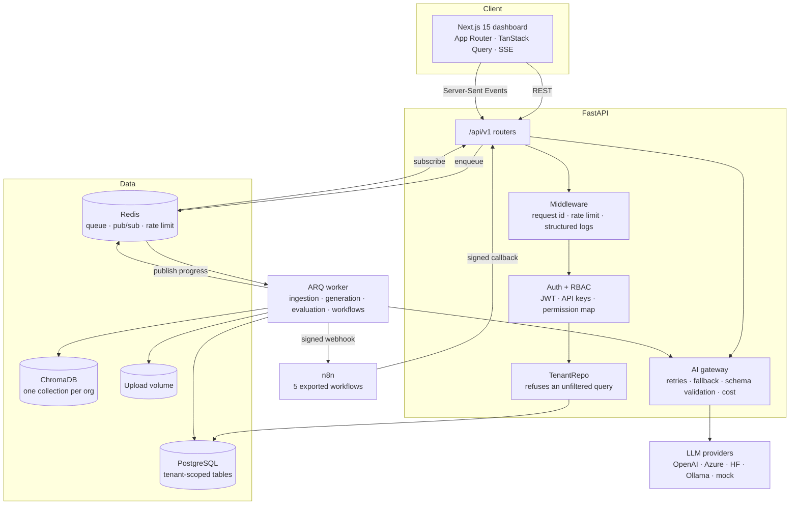
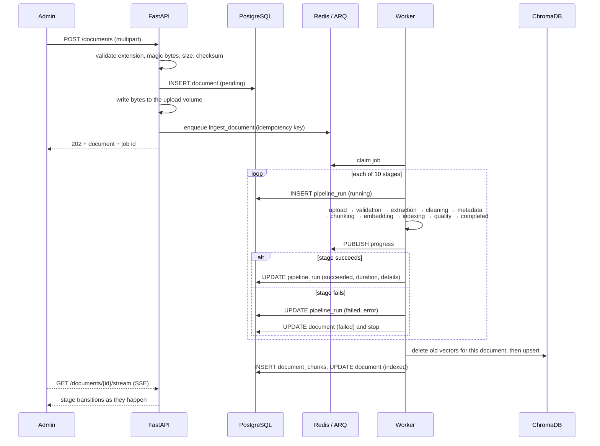
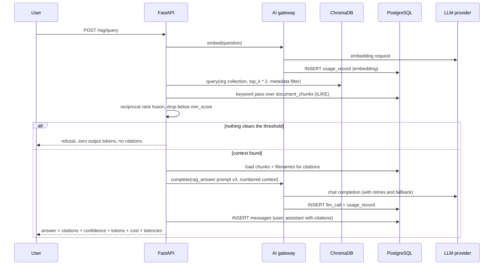
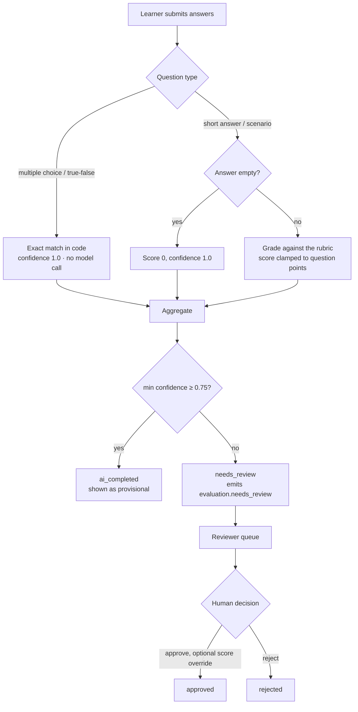
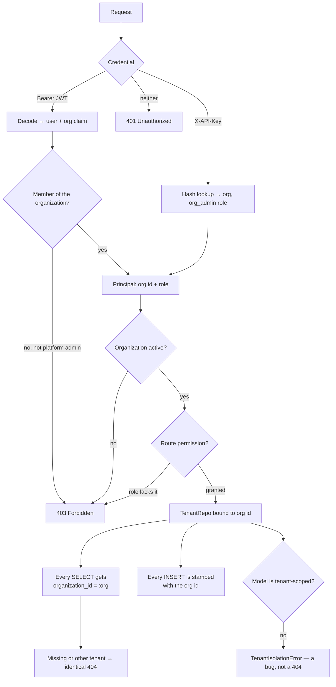

# Architecture

## System overview



## Document ingestion flow



Re-running from a specific stage is a first-class operation:
`POST /documents/{id}/reindex?from_stage=chunking`.

## RAG request flow



## n8n workflow execution

```mermaid
sequenceDiagram
    participant S as Service (e.g. learner created)
    participant E as Event dispatcher
    participant DB as PostgreSQL
    participant Q as Redis / ARQ
    participant W as Worker
    participant N as n8n
    participant API as FastAPI webhook

    S->>E: emit("learner.created", payload)
    E->>DB: INSERT automation_event
    E->>DB: INSERT workflow_execution (queued, idempotency key)
    E->>Q: enqueue run_workflow

    W->>DB: UPDATE execution (running)
    alt workflow has an n8n webhook path
        W->>N: POST /webhook/{path} with X-LearnFlow-Signature
        N-->>W: 200 { executionId }
        W->>DB: store n8n_execution_id, stay "running"
        N->>N: run the nodes
        N->>API: POST /webhooks/n8n/callback (signed)
        API->>API: verify HMAC, check freshness, insert receipt (unique)
        API->>DB: apply steps, status, tokens; mark finished
    else n8n unreachable or not configured
        W->>W: run the built-in equivalent, recording every step
        W->>DB: steps, status, duration, attributed AI cost
    end
    W->>Q: PUBLISH execution updates → SSE to the browser
```

## Assessment evaluation



An API key cannot approve an evaluation — the endpoint requires a user principal.

## Multi-tenant authorization



## Key technical decisions

| Decision | Alternative | Why this one |
|---|---|---|
| ARQ for background jobs | Celery | Async-native, same asyncio stack as FastAPI, no separate protocol layer |
| Isolation by Chroma **collection** | Metadata filter on a shared collection | A forgotten filter leaks other tenants' data; a wrong collection name returns nothing |
| No LangChain / LlamaIndex | Framework-first RAG | Retries, fallback, token accounting and prompt versioning are the interesting parts — hiding them behind a framework would defeat the purpose |
| SSE, not WebSockets | Bidirectional socket | Updates are one-directional; SSE survives any proxy and is ~15 lines |
| Every model call through one gateway | Call providers at each site | Single place for retry, fallback, cost, observability and schema validation |
| Built-in runners beside n8n | n8n only | Tests, CI and the first-run demo work with no n8n; production still routes through it |
| Execution cost by foreign key | Sum LLM calls in a time window | Concurrent runs in one org would otherwise each claim the other's tokens |
| Baseline migration from metadata | Hand-written `op.create_table` | The models are the source of truth for v1; transcribing 30 tables by hand only adds drift |
