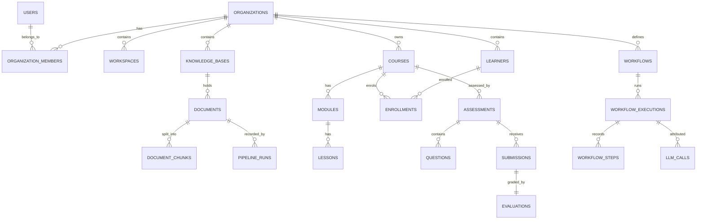

# Database schema

PostgreSQL 16, SQLAlchemy 2.0 declarative models, Alembic migrations. Tests run the same
models on SQLite.

## Conventions

Every table has `id` (UUID v4, generated in Python), `created_at` and `updated_at`
(timezone-aware, defaulted in Python so every row is stored in the same representation —
mixing DB-generated naive timestamps with aware ones makes range filters silently wrong).

Tenant-scoped tables additionally have `organization_id` with `ON DELETE CASCADE`, an index on
it, and a composite `(organization_id, created_at)` index, which is the shape of almost every
list query.

JSON columns are `JSONB` on Postgres and plain `JSON` on SQLite, behind one type alias.

## Tables

### Tenancy

| Table | Notable columns |
|---|---|
| `users` | `email` (unique), `password_hash` (bcrypt over a SHA-256 pre-hash), `is_platform_admin` |
| `organizations` | `slug` (unique), `plan`, `settings`, `is_active` |
| `organization_members` | `(organization_id, user_id)` unique, `role` |
| `workspaces` | Sub-division inside an organization |
| `learners` | `email`, `last_active_at` (indexed — the inactivity query), `reminders_sent`, `profile` |
| `refresh_tokens` | `token_hash` (unique), `expires_at`, `revoked_at` |

### Knowledge

| Table | Notable columns |
|---|---|
| `knowledge_bases` | `embedding_model`, `chunk_size_tokens`, `chunk_overlap_tokens`, counters |
| `documents` | `checksum` (indexed, duplicate detection), `status`, `stage`, `progress`, `error` |
| `document_chunks` | `(document_id, position)` unique, `content`, `token_count`, `page_number`, `section`, `vector_id` |
| `pipeline_runs` | One row per stage attempt: `stage`, `status`, `attempt`, `duration_ms`, `error`, `details` |

`document_chunks.vector_id` is `"{document_id}:{position}"` — the join key between Postgres
and Chroma, and what makes a citation resolvable back to its stored text.

### Learning

`courses` to `modules` to `lessons`; `enrollments` (unique per learner and course, with
`completed_lesson_ids` and `progress`); `assessments` to `questions`; `submissions` to
`evaluations` (one to one).

`evaluations` carries `confidence`, `requires_human_review`, `per_question` (a per-item
breakdown recording whether each was graded by rules or by the model), `reviewed_by` and
`reviewed_at`.

### AI observability

| Table | Purpose |
|---|---|
| `llm_calls` | One row per provider round-trip **including failures**: provider, model, prompt name and version, tokens, latency, cost, success, retry count, whether fallback was used, whether schema validation failed, retrieved chunk ids, tool calls, request id, and the workflow execution it belongs to |
| `usage_records` | Rolled-up billing view, written only on success, indexed on `occurred_at` |
| `conversations`, `messages` | Chat history with citations, tool calls, confidence, refusal flag and user feedback |
| `prompt_templates`, `model_configurations` | Per-organization overrides |

`llm_calls.workflow_execution_id` is what makes per-run cost correct: summing by timestamp
window would let two concurrent runs in one organization each claim the other's tokens.

### Automation

`workflows` (unique `key` per organization) to `workflow_executions` (unique
`idempotency_key` per organization) to `workflow_steps`. Plus `automation_events`,
`webhook_receipts` (unique `signature` — the replay defence) and `support_tickets`.

### Platform

`api_keys` (unique `key_hash`, plus a display `prefix`), `audit_logs`, `jobs` (unique
`idempotency_key`, with `attempts`, `max_attempts`, `progress` and `result`).

## Relationships



## Migrations

```bash
alembic upgrade head
alembic revision --autogenerate -m "add x"
alembic downgrade -1
```

The baseline (`0001_initial_schema`) materialises the schema from the SQLAlchemy metadata
rather than 700 hand-transcribed `op.create_table` calls: the models are the source of truth
for v1, and transcribing them by hand only adds a place for the two to drift. Every migration
after the baseline is a normal autogenerated diff. CI proves the baseline applies to real
Postgres **and** reverses cleanly.
